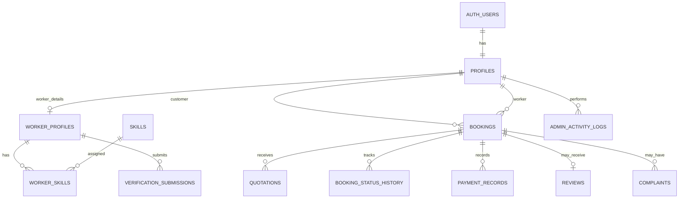

# SkillConnect — Backend Schema

**Project:** Smart Community Labour Networking Platform  
**Recommended backend:** Supabase (PostgreSQL, Auth, private Storage, Row Level Security)  
**Status:** Initial database design for the college project

This schema supports customer and worker accounts, worker verification, job requests, quotations, bookings, payment records, reviews, complaints, and administration.

## 1. Database overview

Core relationships:

- One authenticated user has one application profile and one role.
- A worker profile belongs to one user.
- Workers can have many skills and verification submissions.
- A customer can create many booking requests.
- A booking can have multiple quotations over time, but only one accepted quotation.
- A booking can have payment records, status history, reviews, and complaints.
- Admin users review worker verification submissions and manage platform records.

## 2. Entity relationship diagram



`AUTH_USERS` represents Supabase Auth's managed `auth.users` table. Do not create or manage passwords in your own table.

## 3. Tables

### 3.1 `profiles`

One application profile per authenticated user.

| Column | Type | Rules / purpose |
|---|---|---|
| `id` | `uuid` | Primary key; same value as `auth.users.id` |
| `role` | `text` | `customer`, `worker`, or `admin` |
| `full_name` | `text` | Required |
| `phone` | `text` | Optional initially; validate before booking |
| `email` | `text` | Optional display copy; Auth remains source of truth |
| `avatar_path` | `text` | Storage path, not a public identity document |
| `preferred_language` | `text` | `en` or `te`; default `en` |
| `created_at` | `timestamptz` | Default current time |
| `updated_at` | `timestamptz` | Update timestamp |

Security: users may read/update permitted fields of their own profile. Users must not be able to change their own role to `admin`. Assign admin roles only through a trusted administrative process.

### 3.2 `worker_profiles`

Additional information for worker accounts.

| Column | Type | Rules / purpose |
|---|---|---|
| `id` | `uuid` | Primary key |
| `user_id` | `uuid` | Unique FK to `profiles.id` |
| `bio` | `text` | Optional short description |
| `experience_years` | `integer` | Non-negative |
| `service_area` | `text` | Town/city/area |
| `availability_status` | `text` | `available`, `busy`, `unavailable` |
| `verification_status` | `text` | `pending`, `verified`, `rejected` |
| `created_at` | `timestamptz` | Default current time |
| `updated_at` | `timestamptz` | Update timestamp |

Public profiles may show the verification status, skills, experience, service area, and reviews. They must not expose identity document paths or Aadhaar numbers.

### 3.3 `skills`

Catalogue of platform skills/categories.

| Column | Type | Rules / purpose |
|---|---|---|
| `id` | `bigint` | Primary key |
| `name_en` | `text` | English name, unique |
| `name_te` | `text` | Telugu name |
| `is_active` | `boolean` | Default true |

Seed examples: Masonry, Plumbing, Carpentry, Electrical, Painting, Cleaning, Moving, Gardening.

### 3.4 `worker_skills`

Many-to-many relation between workers and skills.

| Column | Type | Rules / purpose |
|---|---|---|
| `worker_id` | `uuid` | FK to `worker_profiles.id` |
| `skill_id` | `bigint` | FK to `skills.id` |
| `years_experience` | `integer` | Optional, non-negative |
| `created_at` | `timestamptz` | Default current time |

Primary key: (`worker_id`, `skill_id`).

### 3.5 `verification_submissions`

Tracks identity/eligibility proof submitted for worker verification.

| Column | Type | Rules / purpose |
|---|---|---|
| `id` | `uuid` | Primary key |
| `worker_id` | `uuid` | FK to `worker_profiles.id` |
| `document_type` | `text` | e.g. `aadhaar_masked`, `other` |
| `private_storage_path` | `text` | Private bucket path only |
| `status` | `text` | `pending`, `approved`, `rejected` |
| `reviewed_by` | `uuid` | Nullable FK to `profiles.id` |
| `review_note` | `text` | Optional; do not include full identity numbers |
| `submitted_at` | `timestamptz` | Default current time |
| `reviewed_at` | `timestamptz` | Nullable |

Security: keep the storage bucket private, use short-lived signed URLs only for authorized review, restrict database rows to the worker and authorized admins, and never store full Aadhaar numbers unless there is a justified and compliant requirement. Prefer masked Aadhaar or another suitable verification method.

### 3.6 `bookings`

A customer's request for work and its lifecycle.

| Column | Type | Rules / purpose |
|---|---|---|
| `id` | `uuid` | Primary key |
| `customer_id` | `uuid` | FK to `profiles.id` |
| `worker_id` | `uuid` | FK to `worker_profiles.id`; nullable until assigned |
| `skill_id` | `bigint` | FK to `skills.id` |
| `title` | `text` | Short job title |
| `description` | `text` | Work details |
| `service_address` | `text` | Private; only visible to involved parties |
| `service_area` | `text` | Searchable area, avoid exposing exact address publicly |
| `requested_date` | `timestamptz` | Nullable requested date/time |
| `status` | `text` | See lifecycle below |
| `completion_confirmed_at` | `timestamptz` | Nullable |
| `created_at` | `timestamptz` | Default current time |
| `updated_at` | `timestamptz` | Update timestamp |

Suggested `status` values: `requested`, `accepted_by_worker`, `quoted`, `quote_accepted`, `scheduled`, `in_progress`, `worker_completed`, `completed`, `cancelled`, `disputed`.

Do not add a fixed mandatory price to a new booking. The customer sees **“Based on the work — quotation required”** until a worker submits a quotation.

### 3.7 `quotations`

A worker's proposed price and terms for a booking.

| Column | Type | Rules / purpose |
|---|---|---|
| `id` | `uuid` | Primary key |
| `booking_id` | `uuid` | FK to `bookings.id` |
| `worker_id` | `uuid` | FK to `worker_profiles.id` |
| `amount` | `numeric(12,2)` | Required, non-negative |
| `currency` | `text` | Default `INR` |
| `work_scope` | `text` | What is included |
| `materials_included` | `boolean` | Default false |
| `estimated_duration` | `text` | Optional |
| `status` | `text` | `submitted`, `accepted`, `declined`, `withdrawn`, `superseded` |
| `valid_until` | `timestamptz` | Optional |
| `created_at` | `timestamptz` | Default current time |
| `responded_at` | `timestamptz` | Nullable |

A quotation is not the final agreed price until the customer accepts it. Enforce at most one accepted quotation per booking with a partial unique index or a trusted transaction/function.

### 3.8 `booking_status_history`

Audit trail of booking status changes.

| Column | Type | Rules / purpose |
|---|---|---|
| `id` | `bigint` | Primary key |
| `booking_id` | `uuid` | FK to `bookings.id` |
| `changed_by` | `uuid` | FK to `profiles.id` |
| `old_status` | `text` | Nullable for initial state |
| `new_status` | `text` | Required |
| `note` | `text` | Optional |
| `created_at` | `timestamptz` | Default current time |

Prefer writing status changes through a database function or backend operation that validates the allowed transition and records the history in one transaction.

### 3.9 `payment_records`

Tracks payment state and agreement; it is not a substitute for a payment gateway.

| Column | Type | Rules / purpose |
|---|---|---|
| `id` | `uuid` | Primary key |
| `booking_id` | `uuid` | FK to `bookings.id` |
| `payer_id` | `uuid` | FK to `profiles.id` |
| `amount` | `numeric(12,2)` | Non-negative |
| `currency` | `text` | Default `INR` |
| `payment_type` | `text` | `advance`, `final`, `refund` |
| `status` | `text` | `pending`, `paid`, `failed`, `refunded`, `cancelled` |
| `payment_method` | `text` | Optional label such as cash or online |
| `provider_reference` | `text` | Optional payment-provider reference; never store card data |
| `paid_at` | `timestamptz` | Nullable |
| `created_at` | `timestamptz` | Default current time |

Record an advance only if both parties agree and the agreement is captured. Prefer a real payment provider for online payments; do not store card numbers, CVVs, or banking credentials.

### 3.10 `reviews`

A customer's review of a completed booking.

| Column | Type | Rules / purpose |
|---|---|---|
| `id` | `uuid` | Primary key |
| `booking_id` | `uuid` | Unique FK to `bookings.id` |
| `customer_id` | `uuid` | FK to `profiles.id` |
| `worker_id` | `uuid` | FK to `worker_profiles.id` |
| `rating` | `smallint` | 1 through 5 |
| `comment` | `text` | Optional |
| `created_at` | `timestamptz` | Default current time |

Allow a review only from the booking's customer after completion is confirmed. A worker's average rating should be calculated from reviews rather than manually edited.

### 3.11 `complaints`

Support issues related to a booking or user.

| Column | Type | Rules / purpose |
|---|---|---|
| `id` | `uuid` | Primary key |
| `booking_id` | `uuid` | Nullable FK to `bookings.id` |
| `submitted_by` | `uuid` | FK to `profiles.id` |
| `against_user_id` | `uuid` | Nullable FK to `profiles.id` |
| `subject` | `text` | Required |
| `description` | `text` | Required |
| `status` | `text` | `open`, `under_review`, `resolved`, `rejected` |
| `admin_note` | `text` | Internal note |
| `resolved_by` | `uuid` | Nullable FK to `profiles.id` |
| `created_at` | `timestamptz` | Default current time |
| `resolved_at` | `timestamptz` | Nullable |

### 3.12 `admin_activity_logs`

Records important administrator actions.

| Column | Type | Rules / purpose |
|---|---|---|
| `id` | `bigint` | Primary key |
| `admin_id` | `uuid` | FK to `profiles.id` |
| `action` | `text` | e.g. `worker_approved`, `complaint_resolved` |
| `target_type` | `text` | Entity/table type |
| `target_id` | `text` | ID of affected record |
| `details` | `jsonb` | Minimal non-sensitive metadata |
| `created_at` | `timestamptz` | Default current time |

Do not write passwords, private documents, full Aadhaar numbers, authentication tokens, or payment secrets into logs.

## 4. Status and business rules

### Booking lifecycle

```text
requested
  -> accepted_by_worker
  -> quoted
  -> quote_accepted
  -> scheduled
  -> in_progress
  -> worker_completed
  -> completed
```

Cancellation and dispute paths should be handled explicitly. Validate every transition server-side; do not let the frontend set arbitrary status values.

### Quotation and price
1. New booking has no confirmed price.
2. Worker submits a quotation with amount and scope.
3. Customer accepts or declines it.
4. Only an accepted quotation is treated as agreed.
5. If scope or price changes, record a new quotation or explicit change agreement.

### Completion and payment
1. Worker marks work complete.
2. Customer confirms completion.
3. Final payment is recorded according to the agreed terms.
4. Advance payments are optional and must be explicitly agreed.
5. Keep payment records distinct from actual payment processing.

## 5. Security model

Use Supabase Row Level Security (RLS) on every table exposed through the API. These are the intended access rules; implement and test them before real use.

| Data | Customer | Worker | Admin |
|---|---|---|---|
| Public worker profile and skills | Read | Read/update own permitted fields | Read/manage |
| Own profile | Read/update permitted fields | Read/update permitted fields | Manage |
| Own bookings | Read/create and permitted customer actions | Read assigned bookings and permitted worker actions | Manage |
| Quotations | Read quotations for own bookings; accept/decline own booking's quote | Create/manage own quotations | Review as needed |
| Verification documents | No access | Access own submission where appropriate | Authorized verification access |
| Payment records | Read own booking records | Read records for assigned bookings | Manage/reconcile |
| Reviews | Create for own completed bookings; read public reviews | Read own reviews | Moderate under policy |
| Complaints | Create/read own complaint | Create/read own complaint | Review/manage |
| Admin activity logs | No access | No access | Authorized admin read |

Important:
- RLS policies must use `auth.uid()` and trusted role information.
- A user must not be able to promote themselves to `admin`.
- Do not expose Supabase service-role keys in React or any browser code.
- Keep the verification storage bucket private.
- Use database constraints and trusted functions for sensitive state transitions.
- Test access using separate customer, worker, and admin accounts.

## 6. Suggested indexes and constraints

- Index `bookings(customer_id, created_at)`.
- Index `bookings(worker_id, status)`.
- Index `bookings(skill_id, service_area)`.
- Index `quotations(booking_id, created_at)`.
- Index `verification_submissions(worker_id, status)`.
- Index `payment_records(booking_id, status)`.
- Index `reviews(worker_id, created_at)`.
- Check `experience_years >= 0`.
- Check quotation and payment amounts are non-negative.
- Check review rating is between 1 and 5.
- Use foreign keys and suitable `ON DELETE` behavior; avoid cascading deletion of payment/audit history.

## 7. Supabase Storage buckets

Create buckets with these intentions:

| Bucket | Visibility | Contents |
|---|---|---|
| `worker-avatars` | Public or policy-limited | Profile photos only |
| `verification-private` | Private | Masked Aadhaar or other verification documents |
| `booking-attachments` | Private | Optional job photos or documents |

Never place identity documents in a public bucket. Limit file types and sizes. Use short-lived signed links for authorized private access.

## 8. Implementation order

1. Create a Supabase project.
2. Create tables and constraints.
3. Enable RLS on every exposed table.
4. Add role-safe policies and trusted admin assignment.
5. Create the private verification storage bucket and storage policies.
6. Build authentication and profile creation.
7. Build worker profile and skills.
8. Build booking requests and quotations.
9. Add status history, completion confirmation, and payment records.
10. Add reviews, complaints, and admin reports.
11. Test every policy with customer, worker, and admin accounts.

This is a logical schema, not a ready-to-run migration. SQL types, foreign keys, constraints, triggers, indexes, RLS policies, and storage policies must be implemented and tested before deployment.
